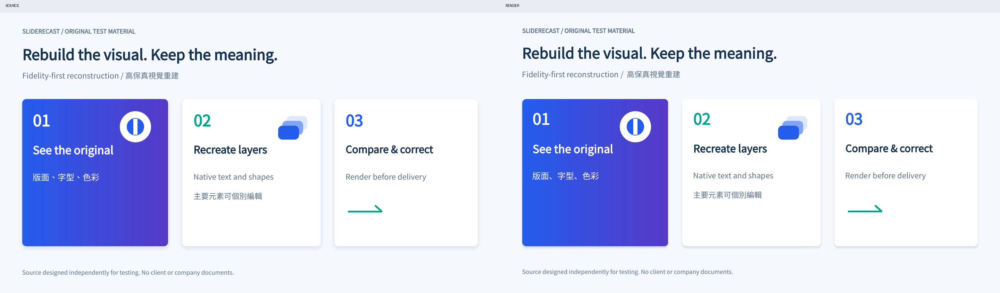

# Image to Editable PPT — SlideRecast

Convert images and PDFs into visually faithful, editable PowerPoint presentations using AI agents.

**Development preview, not a formal release.** The agent preserves wording, layout and appearance, reconstructs major elements as individually editable PowerPoint objects, renders the result, compares it with the source and corrects local differences. It does not redesign slides or restore chart data by default.

Developed independently by the project maintainer.

## What is implemented

- Agent workflow with freedom to choose source-specific code and suitable authoring tools.
- Offline bundles of Office Kit 0.24.1 and PptxGenJS 4.0.1, without a required npm install for users.
- PDF preparation, package/object inspection, original-preserving LibreOffice rendering and region-ranked image differences.
- Original test images/PDF, paired-engine benchmark, native text/shape/chart programmatic editing and negative tests.
- Separate Claude.ai Custom Skill and portable OpenAI Plugin candidate packages.

The target user uploads a ZIP to Claude.ai, then attaches an image/PDF and asks for a faithful editable PPTX. No local VS Code, Node.js, Python or desktop Office subscription should be necessary. Actual account runtime/fonts/rendering capabilities still need testing: direct Claude.ai access currently reaches a sign-in wall. Microsoft/Windows application checks and public directory acceptance are unverified.

## Start here

- [Installation and example prompts](docs/INSTALLATION.md)
- [Canonical agent skill](skills/image-to-editable-ppt/SKILL.md)
- [Evidence and limitations](docs/TEST-LOG.md)
- [Architecture](docs/ARCHITECTURE.md), [research](docs/RESEARCH.md) and [developer setup](docs/DEVELOPMENT.md)
- [Privacy](docs/PRIVACY.md), [provenance](docs/PROVENANCE.md) and [licensing gate](docs/LICENSING.md)
- [Remaining tasks](TASK.md) and [release checklist](docs/RELEASE-CHECKLIST.md)

Example original and paired-engine reconstruction:

Native chart data is opt-in. Shape-based chart visuals stay faithful to the source; an image/SVG layer is disclosed as a picture, not native internal paths. No fixed scene graph, universal conversion CLI, API service or MCP server is required.

Intended future license: Apache-2.0, pending rights and final third-party review. **No project open-source license is granted yet.** Third-party implementations and API declarations retain their own notices. Independent authorship does not eliminate employment, confidentiality or other contractual obligations. No affiliation or endorsement by Anthropic, OpenAI or Microsoft is claimed.
